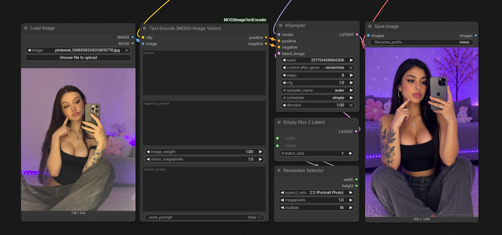

# ComfyUI-MOSSImageTextEncoder

Feeds a reference image through the Qwen3.5-9B **vision tower** and inserts its visual embeddings directly into the text prompt. The image conditions the generation natively through the text encoder.

<!-- SHOWCASE COLLAGE -->


**Note:** This node is for vision/conditioning, not image editing.

## Workflow
A ready-to-use example workflow is included in the repository: `workflow.json`.

Simply drag and drop the `workflow.json` file directly into your ComfyUI workspace to load the entire setup.

## Requirements

* `qwen3.5_9b_*.safetensors` text encoder, `moss_image_*.safetensors` diffusion model,
  `flux2-vae*.safetensors` (for decoding only).
* Load the text encoder through **CLIPLoader** with type **`moss_image`**.
* Latents: use the core **Empty Flux 2 Latent** node (128 channels).

## Text Encode (MOSS-Image Vision)

| Input | Type | Notes |
|-------|------|-------|
| `clip` | CLIP | CLIPLoader → type `moss_image`. |
| `prompt` | STRING | Your text prompt. |
| `negative_prompt` | STRING | Optional negative conditioning. |
| `image` | IMAGE | Optional reference image. A batch is treated as multiple references. |
| `image_weight` | FLOAT | Reference influence applied before the vision tower: `0` ignores it, `1` standard, `<1` fades toward gray, `>1` pushes away from gray. |
| `vision_megapixels` | FLOAT | Max size per reference before the vision tower. Oversized images are downscaled, smaller ones kept native (never upscaled). Default `1.0`. |
| `system_prompt` | STRING | Optional system instruction prepended to the prompt. Empty matches MOSS-Image's normal conditioning. |
| `print_prompt` | BOOLEAN | Dump the assembled Qwen3.5 prompt to the console. |

**Outputs:** `positive`, `negative` (CONDITIONING).


## Typical wiring

```
UNETLoader   (moss_image_sft_*)
CLIPLoader   (type: moss_image, qwen3.5_9b_*)
VAELoader    (flux2-vae)                          # decode only
LoadImage ─┐
           ▼
  Text Encode (MOSS-Image Vision) ── positive/negative ─┐
Empty Flux 2 Latent ────────────────────────────────────┤
                                                        ▼
                                    KSampler ─► VAEDecode ─► PreviewImage
```

Start with `image_weight = 1.0`, `vision_megapixels = 1.0`, denoise `1.0`.

## Install

```bash
cd ComfyUI/custom_nodes
git clone https://github.com/ThetaCursed/ComfyUI-MOSSImageTextEncoder.git
```

Then restart ComfyUI. No extra dependencies — the node only uses `comfy.utils` and the
text encoder you already load.

## Troubleshooting

**The node does not show up after cloning.** This repo has no install step, so a missing
node is almost always the folder layout or a stale process, not the node itself.

1. **Check the folder depth.** ComfyUI scans exactly one level inside `custom_nodes/`.
   Cloning from inside an already-created folder adds an extra level, which is silently ignored:

   ```
   ✅ custom_nodes/ComfyUI-MOSSImageTextEncoder/__init__.py
   ❌ custom_nodes/ComfyUI-MOSSImageTextEncoder/ComfyUI-MOSSImageTextEncoder/__init__.py
   ```

   Fix: `cd custom_nodes/ComfyUI-MOSSImageTextEncoder && mv ComfyUI-MOSSImageTextEncoder/* .`
   (or just re-clone from `custom_nodes/`).

2. **Fully restart ComfyUI.** The node list is built at startup; "Refresh" in the browser
   (or `F5`) does not rescan `custom_nodes/`. Stop the server and start it again.

3. **Clone went to the wrong install.** Portable, Desktop and manual installs each have their
   own `custom_nodes/` (Desktop on Windows: `%USERPROFILE%\Documents\ComfyUI\custom_nodes`).
   Confirm the path from the startup banner — the log line
   `Adding extra search path custom_nodes <path>` shows which one is live.

4. **Check the startup log** for the folder name. A line like
   `Cannot import ... ComfyUI-MOSSImageTextEncoder: <error>` is an actual code/import error —
   paste that line in the issue. No line at all means the folder was not scanned (steps 1–3).

5. **Confirm the clone is complete**, not an empty directory left by a failed/aborted clone:

   ```bash
   ls custom_nodes/ComfyUI-MOSSImageTextEncoder
   # expected: __init__.py nodes.py README.md LICENSE pyproject.toml workflow.json assets
   ```

If it still fails, open an issue with the startup log excerpt and the output of
`git -C custom_nodes/ComfyUI-MOSSImageTextEncoder rev-parse HEAD`.

## License

MIT — see [LICENSE](LICENSE).
